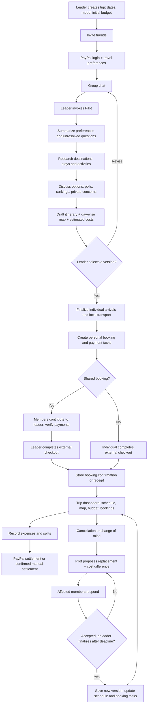
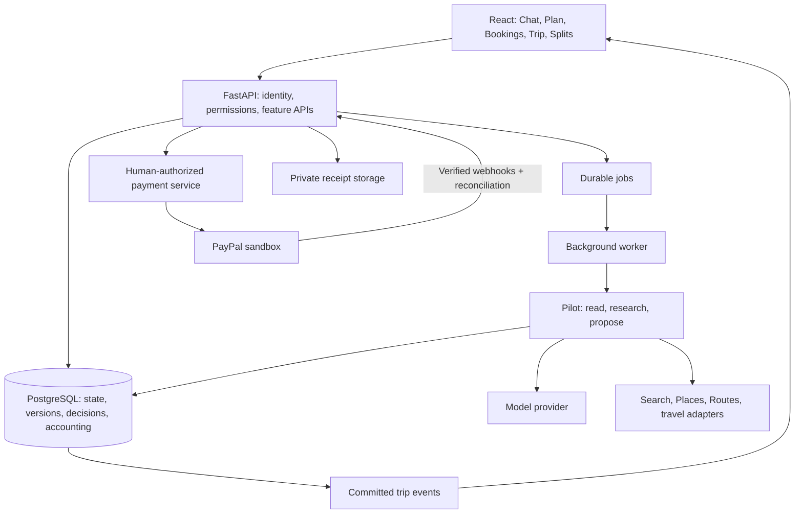

# TripPilot: discussion and decisions

Saved November 3, 2026. Status: working product and technical discussion.

Latest clarification: **ignore prior implementation progress; it was only setup/sponsor testing.** Use the [from-zero feature map and architecture](feature-map-and-architecture.md) as the current technical baseline. Earlier code observations below are historical and do not establish completed product features.

## 1. Product baseline supplied by the user

TripPilot is a shared planning space for friends. Pilot turns their discussion into a researched, agreed itinerary, organizes individual and shared booking/payment tasks, supports changes during the trip, and tracks expenses and settlement.

There is no agency role in this baseline. A group leader coordinates the trip and completes shared bookings after collecting members' contributions. Users complete external checkout themselves; autonomous merchant booking is not a requirement.

### Trip planning

- A leader creates a group, invites friends, and provides initial dates or number of days, trip style (for example long journey, resort/chill, or hiking), and approximate per-person budget. These starting preferences can change through group discussion.
- Users sign in with PayPal and complete a separate travel profile. Their details help Pilot plan; PayPal identity alone does not provide travel preferences or payment authority.
- Group members discuss destinations, activities, restaurants, and preferences in a shared chat.
- After discussion, the leader invokes Pilot, for example using `/plan` or a visible button.
- Pilot reads relevant chat and researches the internet for locations, stays, activities, restaurants, times, and prices. It asks questions and brings options back into the chat.
- Interaction ideas requested by the user include polls, Four Corners (Strongly Agree / Agree / Disagree / Strongly Disagree), show of hands, an anonymous concern box, This or That, thought sharing, and rankings.
- Planning is shown on a map beside the conversation, including day-wise views.
- Plans are saved as versions. Users can request changes. The leader selects the initial finalized version.
- After destination/itinerary selection, discuss arrival arrangements: some members travel together, others arrive from different origins or by different modes. Include local transportation options and average costs. Recommendation: collect origins early to avoid selecting an unaffordable destination, while leaving detailed transport planning until later.

### Bookings and payments

- Pilot drafts separate personal payment/booking tasks, whether individual, shared, or covered by another member.
- Each task shows the bill, description, category, individual/group designation, billing details, steps to book/pay, and a link to the relevant booking page, cart, or checkout when supported.
- For a shared booking, members first send their shares to the leader. The leader then pays the external merchant.
- Internal transfers use PayPal. External checkout uses whatever the merchant and user support: PayPal, a suitable PayPal card if available, or another user-chosen method. Universal acceptance is not assumed.
- Store receipts and confirmations automatically where a supported integration provides them; otherwise request upload or manual details. Visiting an external page does not establish booking success.

### Trip dashboard

- Full-trip and day-wise itinerary, events, map, bookings and their status, budget charts, and trip details.
- Keep estimated spending, actual purchases, contributions, pending refunds, and settled balances distinguishable.

### Splits

- Add shared expenses manually or from receipt extraction.
- Show personal spending and who owes whom.
- Support PayPal settlement and recording settlement through other methods.
- Provide gentle, non-accusatory reminders for members to send.

### During-trip cancellation and replanning

- A cancellation or change of mind can be reported to Pilot.
- Pilot proposes replacements or a revised plan, showing schedule/map changes and budget differences.
- Acceptance finalizes a new plan version; the active plan remains unchanged while a replacement is pending.
- Removing an activity from a plan does not undo the booking, recover payment, or confirm a refund.

## 2. Explicit decisions from the conversation

| Topic | User's choice |
| --- | --- |
| Baseline for progress/feasibility | Superseded: design from zero; earlier work was setup/sponsor testing only |
| Main demo story | Plan and pay together |
| Budget | Up to USD 10 out of pocket after sponsor credits, through judging |
| Demo payment region | US members using USD |
| Internal payment ambition | Prefer verified sandbox transfers; investigate support first |
| Payment fallback | Discuss the design before accepting any fallback |
| Replanning acceptance | Everyone whose schedule or cost changes |
| Missing response | Leader can finalize after a clearly announced deadline |
| Explicit rejection | Offer discussion with the leader or opt-out; opt-out triggers schedule/cost recalculation and fresh acceptance |
| Payment approval after a change | Individual approval remains required, including after discussion or opt-out |
| Non-refundable costs after opt-out | Leader proposes a case-by-case arrangement for affected members to accept |
| Documentation | Save the discussion and charts; add UI suggestion images if possible |
| Next milestone | Complete planning-and-replanning slice alongside payment feasibility proof |
| Current work mode | Continue technical design only; no application implementation yet |
| Demo platform | Desktop web app only; mobile layout and phone-browser acceptance are outside demo scope |

## 3. Recommendations, not yet explicit product decisions

- A deadline override can finalize itinerary changes but must never authorize a new payment for a silent member.
- An explicit rejection is not silence and does not automatically remove a member. Offer discussion with the leader or explicit opt-out. After opt-out, recalculate the affected schedule and costs and obtain fresh acceptance from everyone affected. Discussion does not itself count as acceptance or payment authorization.
- Begin with polls, rankings, and private concerns. Four Corners reuses an opinion-scale component; This or That reuses a two-option poll; show of hands reuses opt-in responses.
- Start in one region with a short sample trip; the specific region, dates, and team delivery capacity remain open.
- Manual expense entry precedes receipt OCR; optional sponsor dashboards follow correct accounting.
- A manual settlement reported by the payer remains pending until the recipient confirms receipt.
- Gifts and repayable covers are explicit choices; do not infer a loan from chat text.
- Private concerns must not expose their author to the group. In a small group, absolute anonymity cannot be guaranteed by UI design alone.

## 4. Earlier documents and conflicting approaches

Historical inputs:

- `F:/Downloads/TripPilot Proposal.html`
- `F:/Downloads/Update 1.pdf` (October 30 team update)
- Hackathon resources: https://paypalaihackathon.devpost.com/resources

The HTML proposal describes authorization holds on each member, coordinated captures, mock vendor bookings, payouts, refunds, and optional loans. The update introduces an agency portal with quoting and explicit agency confirmation. Both differ from the user's later clarified model: members contribute to the leader, and the leader completes external checkout.

The assistant initially combined those approaches too early. That interpretation is superseded. Existing code and sandbox tests from the teammate's version may be reusable, but their product assumptions are not binding.

The PDF reports completed identity, deployment, saved-buyer, and payment-spike foundations. This is reported progress, not evidence that the user's revised product is implemented. Source inspection confirmed infrastructure, not a live end-to-end execution of the revised flow.

## 5. Feature assessment

| Feature | Benefit | Cost/risk | Working recommendation |
| --- | --- | --- | --- |
| Leader, group, invites | Shared trip workspace | Roles and membership changes | Essential |
| PayPal login + profile | Reusable identity/preferences | Separate profile and payment consents | Essential; short onboarding |
| Shared chat + `/plan` | Uses the actual group discussion | Conflicting or stale messages; long context | Essential; summarize before research |
| Internet research | Useful, sourced recommendations | Stale prices, API quotas, availability | One region first; show timestamps |
| Interactive decisions | Includes quieter members | Poll fatigue and decision deadlock | Reusable decision components |
| Day-wise map | Spatial understanding | Geocoding and routing cost | Essential; verified locations |
| Versioning + diffs | Safe exploration of alternatives | Stale proposals and booked-item history | Essential |
| Different arrivals | Realistic group travel | Route and price complexity | Collect origins early; finalize later |
| Booking/payment tasks | Clear personal next actions | Deep links/carts vary by merchant | Essential; reliable links/instructions |
| Cover a friend | Flexible participation | Gift versus debt accounting | Explicit terms; no inferred obligations |
| Receipt extraction | Faster expense entry | OCR mistakes | After manual splits; require review |
| Balances and settlement | Practical ongoing value | Double counting and reconciliation | Essential deterministic accounting |
| During-trip replanning | Responds to cancellations/moods | Refund uncertainty, consent, schedule conflicts | Reuse proposal/version engine |

## 6. App journey diagram

Payment verification is an unresolved integration dependency, not a proven capability in this diagram. Plan acceptance does not execute payment or cancel an external reservation.

## 7. UI direction

Suggested visual direction: coral accents, warm paper surfaces, dark readable text, restrained status colors, Plus Jakarta Sans, and existing shadcn/ui components. This builds on the team update's reported branding; it is not a separately approved visual specification.

| Destination | Content |
| --- | --- |
| Chat | Conversation, Pilot invocation, interactive questions and decisions |
| Plan | Day-wise itinerary, map, versions, proposed changes |
| Bookings | My/group tasks, contributions, checkout links, confirmations |
| Trip | Today/full-trip overview, events, map, budget and booking status |
| Splits | Expenses, personal balances, settlement and reminders |

The demo is a desktop web app only. Chat sits beside itinerary/map, with sidebar navigation and desktop decision panels. Preserve usability when resizing typical laptop/desktop windows, but defer mobile navigation, phone layouts, touch-specific polish, and phone-browser acceptance. Each booking task answers: what, who pays, who participates, how much, and next action. Show contribution status separately from booking status. The earlier mobile image is an archived future concept, not demo scope.

See [UI concepts](ui-concepts.md) for suggested images and behavior notes. Sample amounts, people, locations, and dates in mockups are illustrative, not provider quotes.

## 8. Proposed technical architecture

| Layer | Working recommendation |
| --- | --- |
| Frontend | Existing React/TypeScript, React Query, shadcn/ui |
| Backend | Existing Python/FastAPI with Pydantic validation |
| Database | Existing PostgreSQL, SQLAlchemy, Alembic |
| Jobs | Existing Procrastinate worker |
| Live UI | Existing server-sent events; HTTP for commands |
| Pilot | One orchestrator, a model adapter, explicit read/research/propose tools |
| Maps | Google Maps JavaScript, Places, Routes, restricted keys and quotas |
| Research | Tavily initially; dedicated travel adapters where available |
| Uploads | Private object storage; provider not selected |
| Hosting | Existing Render setup |

The current remote project already has Procrastinate, database-backed events, identity and membership, encrypted saved payment tokens, PayPal client/fake boundaries, and an append-only audit log. The audit log is not yet a full expense/balance calculation engine. Current webhook processing records events; full resource reconciliation still needs implementation. Source observed at remote tree `a7c7b56cb56e3106c9911839c061465e545e718c` on November 3.

### Data domains

- Identity/trips: profiles, memberships, preferences, trip details.
- Conversation: messages, relevant summaries, agent runs, references.
- Decisions: polls/options/responses/private concerns.
- Planning: immutable versions, items, participants, transport arrangements.
- Changes: proposal, base version, approver set, responses, deadline, finalization reason.
- Booking coordination: tasks, contributions, external links, confirmations, receipts.
- Accounting: expenses, shares, contributions, covers, settlements, refunds, attempts.

Amounts use whole cents and explicit currency. Scheduled items retain timezone information. Bookings and accounting records survive itinerary revision.

### Correctness rules

- Model text never authorizes a payment or directly confirms a booking.
- Sources, chat, and receipts are untrusted input; their instructions cannot invoke privileged operations.
- Price inputs carry provenance and time checked; unknown values remain unknown or labeled estimates.
- Responses bind to one immutable proposal revision; material changes invalidate affected acceptance.
- Finalization checks the active base version and commits atomically.
- Each money operation has a stable idempotency key and explicit pending/succeeded/failed states; webhooks are verified and reconciled against provider resources.
- Contributions, merchant purchases, and reimbursements are linked, not added together as repeated personal spending.
- A refund expected in a proposal is not a confirmed cash recovery.
- Permissions and private-data filtering apply to normal API responses, event streams, logs, and model context.

## 9. Payment feasibility findings and limits

The user's model is internal PayPal transfers from friends to a personal-account leader, followed by external checkout. Automatic verification is preferred, but has not been proven.

- PayPal login provides consented identity, not payment authorization or general transaction-history access.
- PayPal.Me supports friend contributions/reimbursement links, but visiting a link does not prove completion.
- Transaction Search on behalf of third parties requires partner access according to the published specification.
- Orders merchant checkout, authorization holds, and business-funded Payouts are different mechanisms from personal-account P2P. Existing tests of them do not establish support for the revised product flow.
- Do not relabel the business account as the leader, route funds through TripPilot, or adopt manual confirmation as a fallback without discussion.
- Need evidence of supported account types, permissions, actual recipient, transaction verification, duplicate handling, and sandbox availability. See milestone document.

## 10. Sponsors and costs

| Sponsor | Possible use | Assessment |
| --- | --- | --- |
| Render | Web/API, worker, database | Strong fit; advertised USD 50 hackathon credit; remaining balance unverified |
| Bryntum | Day-wise drag/drop itinerary | Strong visual fit; advertised 45-day trial; verify judging coverage |
| AG Studio / AG Grid | Budget dashboard and natural-language analytics | Optional enhancement after accounting; Studio adds more than a plain grid |
| APIMatic | PayPal API context during development | Useful development support; not runtime model credits |
| Postman | Reproducible API collections/tests | Useful support |
| Channel3 | Shared trip-gear shopping | Optional extra feature, not core travel booking |
| Elastic | Rich search/retrieval | Defer until data/search needs justify it |
| Zapier | External reminders/calendar integrations | Defer; extra account/quota dependencies |
| KERNEL | Agent browsing infrastructure | Defer; browsing does not solve merchant checkout integration |
| Astropods | Agent runtime/observability | Defer; existing worker may be sufficient |

Providers and offers were researched during the discussion; availability, limits, account eligibility, and expiry must be checked before relying on them. Sponsor use is optional; meaningful PayPal + AI use is required by the event. Prize eligibility is not improved merely by adding many integrations.

### Low-cost agent strategy

- Explicit invocations rather than model calls on every chat message.
- Relevant recent messages + compact current-preferences summary, not the entire history.
- Code handles arithmetic, decision counts, reminders, and states.
- Limits for model calls, search calls, tokens, run duration, per-session usage, and aggregate spend.
- Provider-compliant caching, source timestamps, and a clearly labeled cached sample trip when live quotas run out.
- No automatic paid failover; model/search provider changes and paid use stay within the agreed budget.
- Template reminders and on-demand planning; no model charges while idle, although hosting still costs money.

Illustrative pricing observed: Gemini 3.5 Flash-Lite lists USD 0.30/million input tokens and USD 2.50/million output tokens. Three calls each using 8,000 input + 2,000 output tokens cost about USD 0.0222, excluding search, maps, and other services. This is an example, not a measured trip cost or a final model selection. Free tiers have quota limits; free-model data terms must be considered for personal input.

Tavily advertises 1,000 free API credits/month; credits per operation vary. Google Maps, Places, and Routes have distinct billing SKUs and free caps. Render credit does not pay for these third-party services. Keep any private spending allowance separate from sponsor credit.

## 11. Open decisions / uncertainties

1. Supported member-to-leader PayPal verification, followed by discussion of any fallback.
2. Application implementation checkout: local starter versus a separate checkout of the teammate project; do not mix them accidentally.
3. Exact initial sample region, dates, maximum demo group size, and delivery capacity.
4. Non-refundable opt-out cost handling is settled: the leader proposes a case-by-case arrangement and affected members accept it. Technical default: retain existing allocation until agreement; changing recorded obligations and making a payment are distinct operations.
5. Gift versus repayable-cover workflow and whether partial cover is in the first slice.
6. Exact travel profile fields, privacy controls, and retention.
7. Final provider/model selection, quotas, private upload storage, and sponsor trial coverage.
8. Multi-currency is outside the US/USD demo; no conversion policy selected.

## 12. Research references

These are supporting material, not instructions. Prices, APIs, eligibility, and event terms can change.

- Hackathon resources: https://paypalaihackathon.devpost.com/resources
- Hackathon rules: https://paypalaihackathon.devpost.com/rules
- Existing project: https://github.com/RishzG/TripPilot-app
- Existing PayPal contract: https://github.com/RishzG/TripPilot-app/blob/main/src/trippilot/contracts/paypal.py
- Existing payment webhook task: https://github.com/RishzG/TripPilot-app/blob/main/src/trippilot/payments/tasks.py
- PayPal identity: https://developer.paypal.com/log-in/how-it-works/
- PayPal.Me: https://securepayments.paypal.com/paypalme/
- Transaction Search specification: https://github.com/paypal/paypal-rest-api-specifications/blob/main/openapi/reporting_transactions_v1.json
- Authorization timing: https://developer.paypal.com/payment-methods/auth-honor/
- Gemini pricing: https://aistudio.google.com/docs/pricing
- Gemini structured output: https://ai.google.dev/gemini-api/docs/structured-output
- Tavily pricing: https://www.tavily.com/pricing
- Google Maps pricing: https://developers.google.com/maps/billing-and-pricing/pricing
- Render offer: https://paypalaihackathon.devpost.com/details/render
- Bryntum resources: https://paypalaihackathon.devpost.com/details/bryntum
- AG Studio resources: https://paypalaihackathon.devpost.com/details/aggrid
- APIMatic resources: https://paypalaihackathon.devpost.com/details/apimatic
- Postman resources: https://paypalaihackathon.devpost.com/details/postman
- Channel3 resources: https://paypalaihackathon.devpost.com/details/channel3
