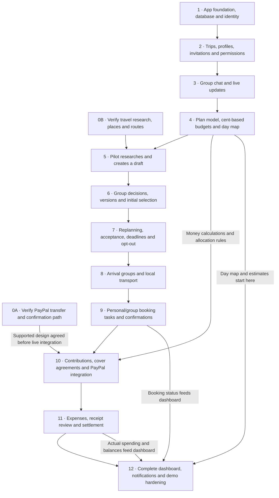
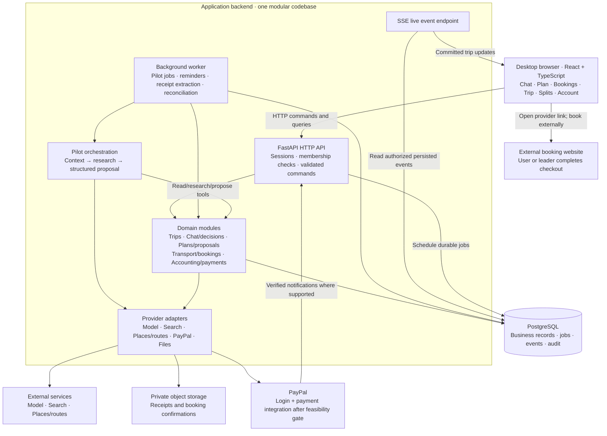

# TripPilot: feature implementation map and project architecture

Prepared November 3, 2026. **Current planning baseline: design from zero.** All previous application work is treated as setup/sponsor experiments. No product feature, integration, migration, deployed service, or test is assumed complete or reusable. Preserve the old files as history; do not delete/reset code as part of planning.

This document supersedes earlier reuse/progress assumptions. The user's product rules remain: desktop web demo, friend groups, Pilot-assisted discussion/planning/replanning, leader-completed shared external checkout, US/USD internal PayPal ambition, individual payment approval, and explicit affected-member agreement for financial changes. Work remains technical design only.

## 1. Feature map: implement in this order

The order is driven by dependencies and reviewable outcomes, not the order in which users see screens. Stage 0 begins immediately alongside stage 1. Each stage adds behavior to a usable app; do not wait until the end to assemble the journey. No schedule estimate assumes old work is already complete.

| Order | Features to implement | Depends on | Completion check |
| --- | --- | --- | --- |
| 0A | PayPal feasibility: identity separately from member-to-leader transfer initiation and server verification; identify account types, permissions, sandbox support and recipient evidence | None | Exact intended payment route demonstrated, or documented unresolved/access-gated verdict; discuss any fallback before selecting it |
| 0B | Travel-data feasibility: research sources, place identification, map/route lookup, prices and provider links | None | One destination has attributable recommendations, real place IDs/coordinates, route evidence, and honest estimate/availability labels |
| 1 | Desktop shell, navigation, database/migrations, API contracts, sessions/PayPal identity, job execution, logs and basic deployment/CI | None; identity findings from 0A | A signed-in user can load the app, an authorized API call works, a durable test job survives restart, and health checks pass |
| 2 | User travel profile; trip creation/editing; leader/member roles; invite/join/member list; private preference visibility | 1 | Leader creates a group, friends join, preferences persist, and users cannot access another trip or another member's private fields |
| 3 | Group chat, message history, live updates/reconnect, explicit `/plan` invocation/button, private concern submission | 2 | Multiple desktop sessions exchange persisted messages; private submissions stay private; invoking Pilot creates a visible queued request |
| 4 | Structured itinerary items; immutable draft versions; participant assignments; deterministic money/share calculations; day map; basic budget summary | 2; chat association from 3 | A manually seeded draft renders by day, sources/estimates are distinguishable, and per-person cents add up |
| 5 | Pilot context summary, bounded internet research, clarifying questions, sourced itinerary draft, run progress/errors and usage limits | 0B, 3, 4 | Real group discussion produces a structured plan with locations, times, cost inputs, source links and a map |
| 6 | Group decision components; polls/This or That, Four Corners, show of hands, ranking and freeform feedback; prompted revisions; version comparison; leader's initial selection | 3, 4, 5 | Discussion and responses inform a revised draft; leader selects an initial version and old versions remain inspectable |
| 7 | During-trip cancellation/change request; alternatives; schedule/map/budget diff; affected-member responses; deadline handling; leader silence override; discussion/opt-out and recalculation | 4, 5, 6 | Group can replace an activity, finalize a new version, and see correct participant/cost changes without losing the previous plan |
| 8 | Detailed arrivals from different origins; travel-together groups; flight/train/car options; local transport and estimated shared/personal costs | 2, 4, 6; use route tools from 0B/5 | Each member has an arrival arrangement; shared local transport updates participants and cost estimates |
| 9 | Personal/group booking tasks; bill/category/payer/participants/instructions; external provider link; owner/leader checkout workflow; private confirmation/receipt upload | 4, 6, 8; private file storage | Everyone can identify what to book/pay next; funding, external booking, and confirmation states are separate |
| 10 | Contribution requests and allocation records; agreed PayPal connection; independent payment verification/reconciliation; cover-a-friend terms; refunds; accepted non-refundable cost arrangements | 0A decision gate, 4, 7, 9 | Intended contributions are tracked once with verifiable evidence; covers/arrangements require acceptance and do not double-count purchases |
| 11 | Manual expenses and participant splits; personal spending/balances; settlement suggestions; PayPal settlement on the agreed supported route; confirmed external settlement; receipt extraction/review; gentle reminder drafts | 4, 9, 10 for connected money; manual expenses can start after 4 | Expense totals and balances reconcile; receipt extraction is reviewed; pending/manual payments never silently become settled |
| 12 | Complete full-trip/today dashboard; estimate-vs-actual charts; booking/event/activity projections; notification/deadline polish; demo seed/reset, quota fallbacks and end-to-end checks | Build incrementally from 4, then 9–11 | A desktop reviewer completes the journey, including a change, opt-out and money-history inspection, without explanation |

Stage 6 expands decision types incrementally: start with a reusable choice/response model, then add opinion scales, opt-in, ranking, and private/freeform modes. A suggested response to a poll is not permission to change a financial obligation.

The dashboard begins with itinerary, map, and estimated budget in stage 4; stage 12 completes and polishes it. Receipt extraction comes after manual expense entry. Sponsor-specific widgets are added when their underlying feature exists, not before the feature works.



## 2. Review checkpoints

| Checkpoint | What can be demonstrated | What is deliberately not claimed |
| --- | --- | --- |
| A · Group workspace (1–3) | Sign in, create/join, preferences, shared chat, private concerns | An intelligent planner or verified transfer |
| B · Planning and replanning (4–7) | Research → draft/map → discussion → version selection → cancellation → replacement acceptance | An external booking, cancellation, refund or payment executed by accepting a plan |
| C · Booking coordination (8–9) | Arrivals, local travel, each person's booking tasks, external checkout handoff, uploaded confirmations | Universal prefilled carts or automatic tracking of arbitrary merchant pages |
| D · Group money (10–11) | Agreed payment integration, contributions, expense balances, covers, arrangements and settlements | Personal-account transfer support before proof or another member's silent financial consent |
| E · Complete demo (12) | Desktop trip overview and full flow with errors/retries/history | Mobile support or global/multi-currency coverage |

**First useful milestone:** checkpoint B, built from zero, while 0A payment feasibility runs alongside it. Checkpoint B should include a small complete path, not every poll type or advanced dashboard widget. This is an implementation priority, not removal of the other discussed features.

## 3. Recommended architecture

Use a **modular monolith**: one backend codebase split by business responsibility, deployed as a web/API process and a worker process. Add PostgreSQL and private file storage. The worker runs slow/retryable work; the API handles permissions, queries and short commands. This recommendation is independent of the old experiments.



| Component | Responsibility | Suggested technology / reason |
| --- | --- | --- |
| Desktop frontend | Forms, chat, decisions, map, comparisons, dashboards | React + TypeScript, Vite, React Query and a consistent component library; ordinary desktop web app |
| HTTP API | Identity/session checks, membership, typed commands/queries, request validation | Python/FastAPI + Pydantic; generates an OpenAPI contract for the frontend |
| Business modules | Plan acceptance, itinerary state, booking coordination, accounting and permission rules | Ordinary application services with explicit module boundaries; independent of model prose |
| Worker | Pilot research jobs, deadline processing, receipt extraction, reminders, provider reconciliation | A durable PostgreSQL-backed queue such as Procrastinate; scheduled jobs/retries without another queue datastore |
| PostgreSQL | Source of truth for trips, versions, decisions, jobs, payments and events | Relational constraints and transactions suit acceptance and money-state changes |
| Live updates | New messages, run progress, responses, plan changes and booking status | HTTP for writes, SSE for server-to-browser updates; persist events and recover after reconnect |
| Private object storage | Receipts and booking confirmations | S3-compatible/private provider, temporary authorized access; exact provider remains open |
| Pilot | Context selection, research, questions and structured proposals | One bounded orchestrator with typed tools and a replaceable model provider; final model/runtime selected by evaluation |
| External adapters | Model/search/maps/PayPal/files | Small interfaces isolate quotas, failures and provider-specific representations |
| Deployment | App/static frontend, API, worker, database | Render is a sponsor candidate; select hosting on capability and verified available credit, with no old deployment assumed |

Do not add microservices, Redis, a vector database, browser automation, or multiple autonomous agents without a demonstrated need. Trip context can begin as structured preferences, recent messages, and an explicit summary.

Technical references checked for this plan: [FastAPI](https://fastapi.tiangolo.com/) and [Procrastinate](https://procrastinate.readthedocs.io/en/stable/). No exact library versions or prices are pinned by this design.

## 4. Backend module map

| Module | Owns | Depends on |
| --- | --- | --- |
| Identity and access | User identity, sessions, profile visibility | PayPal identity adapter, database |
| Trips and members | Group, preferences, roles, invitations and membership | Identity/access |
| Chat and decisions | Messages, private concerns, polls/options/responses, rankings | Trips/access |
| Planning | Itinerary items, immutable versions, source references, current selection | Trips, deterministic estimates, provider results |
| Proposals and acceptance | Revisions, affected-member sets, deadlines, discussion, opt-out, finalization reason | Planning, membership, accounting previews |
| Transport | Member arrivals, travel groups, local transport options | Planning, members, places/routes adapter |
| Booking coordination | Tasks, payer/participants, provider links, booking state, confirmations | Selected plan, transport, files |
| Accounting | Expenses, allocations, balances, covers, cost arrangements, settlement obligations | Membership and linked booking/expense evidence |
| Payments | Payment requests/attempts, supported PayPal operations, verification, reconciliation and reversals | Accounting, explicit approval, PayPal adapter |
| Pilot | Runs, summaries, typed research/read/propose tools, source/cost limits | Authorized services above; no privileged money tool |
| Dashboard | Read-only projections of schedule, budget, bookings and balances | Committed domain state; not a second source of truth |
| Events, jobs and files | Durable event delivery, job lifecycle, upload metadata/access | Database and private storage |

Keep accounting independent of payment-provider terminology: a contribution is a transfer, a merchant expense is a purchase, and a settlement clears an obligation. Recording one does not automatically create or erase the others.

## 5. Data and interface foundations

Main records, introduced only when their feature is built:

- User, TravelProfile, Trip, Membership, Invite.
- Message, PrivateConcern, Decision, DecisionOption, DecisionResponse.
- PilotRun, ResearchReference, PlanVersion, PlanItem, Participation.
- ChangeProposal, ProposalResponse, TransportArrangement.
- BookingTask, BookingConfirmation, Attachment.
- Expense, ExpenseAllocation, Contribution, CoverAgreement, CostArrangement, Settlement.
- PaymentAttempt, ProviderEvent, AuditEntry, TripEvent, Job/Outbox.

Use whole cents with an explicit currency; the demo is USD. Store timestamp/timezone information for schedules. Keep immutable plan/proposal revisions and immutable payment/audit history; corrections use new entries rather than deleting past payments.

Public API groups: `/auth`, `/me`, `/trips`, trip `/members` and `/messages`, `/decisions`, `/pilot-runs`, `/plans` and `/proposals`, `/transport`, `/bookings`, `/expenses`, `/contributions` and `/settlements`, plus authorized events and uploads. Exact request schemas should be fixed per checkpoint rather than inventing every future endpoint now.

Critical contracts:

- Pilot returns structured proposals with source IDs and cost inputs, not executable money commands.
- The backend computes shares and displayed budget differences.
- A long job returns a run ID and progress; it does not hold an HTTP request open for the entire search.
- A proposal names its base version, affected-member set and deadline. Revision invalidates affected acceptance; stale finalization returns a conflict.
- Only committed, authorized data enters the event stream. Private concerns remain private in queries, events, logs and model context.
- Use stable idempotency keys for retryable money commands. Reconcile ambiguous provider results before sending another operation.
- Store durable dispatch intent with state changes so an API/worker restart does not lose work.

## 6. Pilot and replanning flow

1. Member/leader explicitly requests planning or a change.
2. API validates access, records the request/base version and schedules a job.
3. Worker reads relevant authorized chat, agreed preferences, current plan and booking/cost constraints.
4. Pilot researches through bounded tools and returns a structured draft, assumptions, sources and questions.
5. Application validates the draft, calculates shares and publishes a proposal/map/diff.
6. Initial selection belongs to the leader. During-trip changes require affected-member acceptance, or the agreed leader action after silence and an announced deadline.
7. Rejection offers discussion or opt-out. Opt-out produces recalculated schedules/costs and fresh acceptance.
8. Non-refundable charges remain recorded. Leader proposes a separate case-by-case allocation arrangement for affected members to accept.
9. Finalization atomically selects a new version and updates read projections/tasks. External booking, cancellation, refunds and actual payment remain separate actions.

Run one planning job per trip at a time, with bounded calls/time and usage records. Label cached/estimated results and show recoverable quota/provider errors. Keep budget control server-side.

## 7. Payment gate

Desired flow remains member → leader through PayPal, then leader → external merchant through the merchant's supported checkout. PayPal login is independent of this transfer capability.

Do not select Orders checkout, business-funded payouts, personal payment links with manual confirmation, platform custody, or authorization holds as an implicit substitute. The user requires discussion before a fallback.

The proof must establish intended sender/recipient account types, consent, eligible access, actual sandbox execution, server-verifiable recipient/amount/currency/status, and replay/reversal handling. Ordinary app webhooks do not expose every unrelated personal transfer: PayPal documents app-specific event scoping. [Official webhook scope](https://developer.paypal.com/api/rest/webhooks/)

See [payment evidence](payment-feasibility.md) for dated research. Prior sponsor/setup tests count as experiments only; no payment milestone is complete on that basis.

## 8. Dashboard and sponsor placement

- Build the initial day map and estimate summary with stage 4.
- Add selected-plan and change status with stages 6–7.
- Add arrival/bookings/funding status with stages 8–10.
- Add actual spending, personal shares and balances with stage 11.
- Finish aggregation, errors, history and demo polish in stage 12.
- Bryntum is an optional itinerary component in stages 4/6/7.
- AG Grid/Studio is an optional expense/budget presentation layer in stages 11/12.
- APIMatic/Postman support integration work, especially stage 0A/10.
- Render is a hosting candidate in stage 1 onward. Provider availability/credits and trials need confirmation before reliance.

Images in [the UI gallery](ui-concepts.md) visualize the intended behaviors; they do not select a library or establish implementation progress.

## 9. Suggested project organization

```text
trippilot/
  apps/
    web/                 # Desktop React app, grouped by user feature
    backend/
      app/
        identity/
        trips/
        chat/
        decisions/
        planning/
        proposals/
        transport/
        bookings/
        accounting/
        payments/
        pilot/
        dashboard/
        infrastructure/  # Database, events, jobs, files, provider adapters
      tests/
  docs/
    planning/
  scripts/               # Demo seed/reset and explicit sandbox proof tooling
```

The API and worker run from the same backend package. This is a proposed organization for a fresh implementation, not a claim about current files. No application folders are moved by this planning task.

## 10. Verification plan and remaining choices

At each checkpoint, test the behavior that could fail: unauthorized trip/private data access; messages and events after reconnect; structured-output failures; source/price uncertainty; uneven-cent splits; stale proposals; changed participation; silence versus rejection; financial agreement without transfer; duplicate payment notifications; unconfirmed external settlement; receipt extraction errors; restart and quota behavior.

Desktop acceptance targets can start at 1366×768 and 1920×1080 with keyboard operation. Demo reset must isolate sessions and preserve truthful payment status.

Remaining choices are deliberately bounded: supported PayPal route; sample region/dates/group fixture; model/search/map providers and allowed spend; private upload provider; final cover terms; and team delivery capacity. These affect detailed implementation and estimates, but do not prevent the feature dependency map above.

