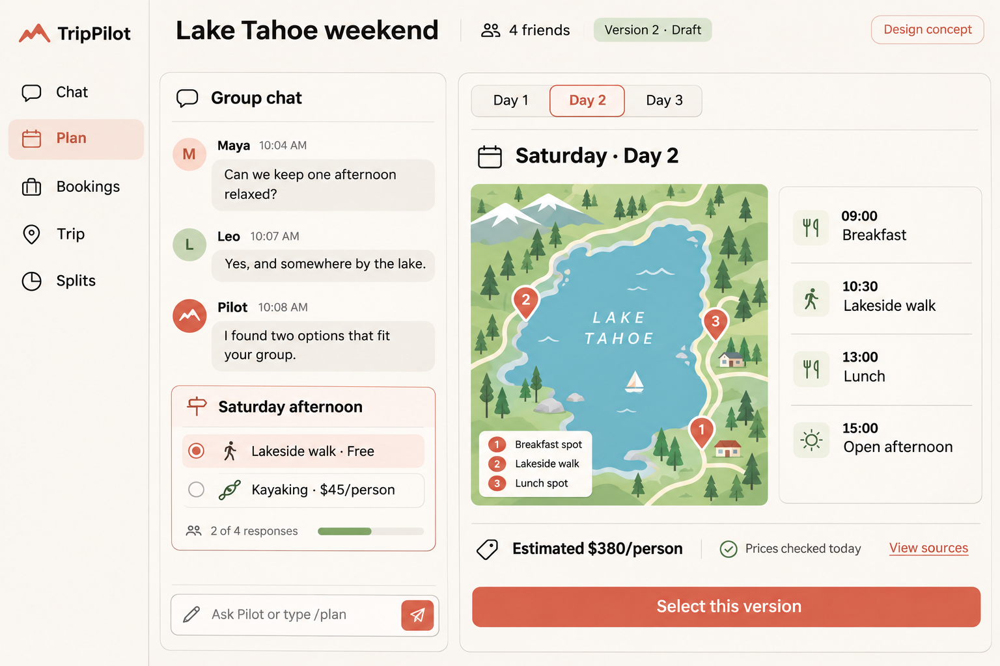
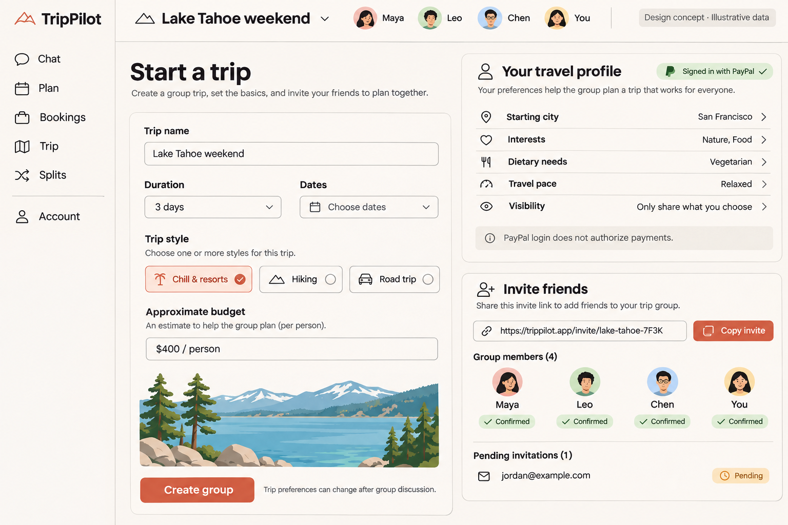
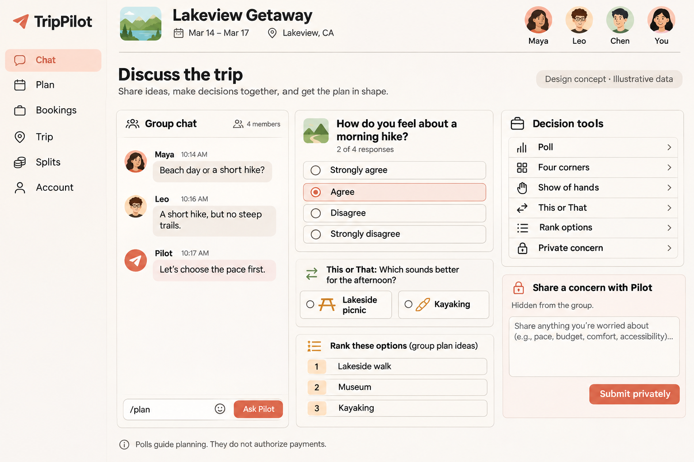
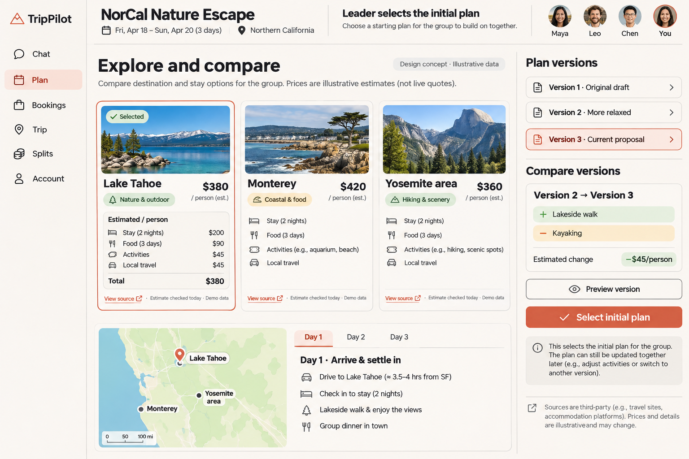
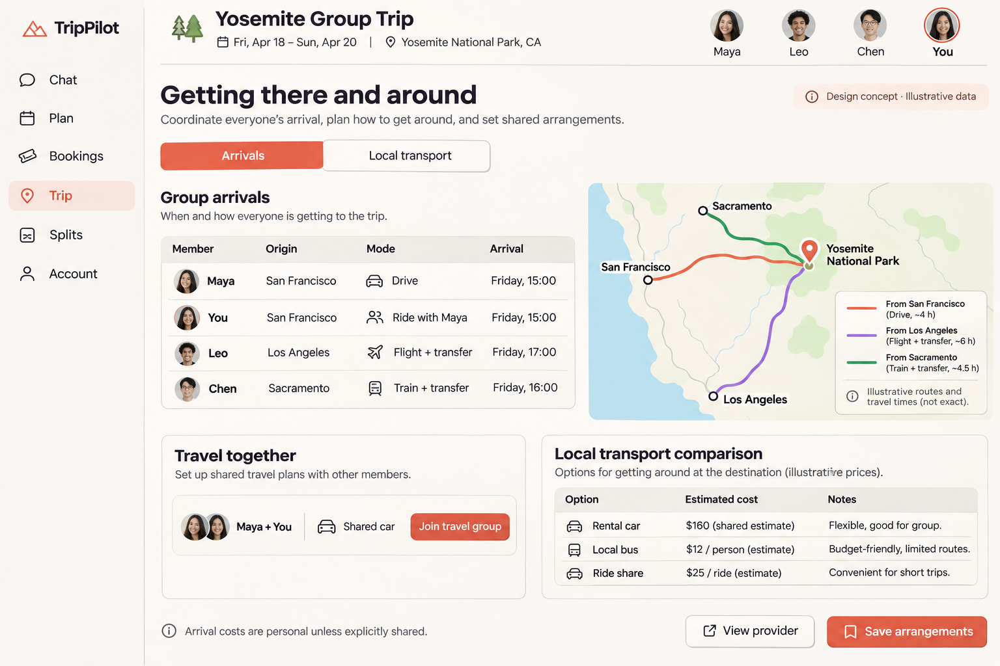
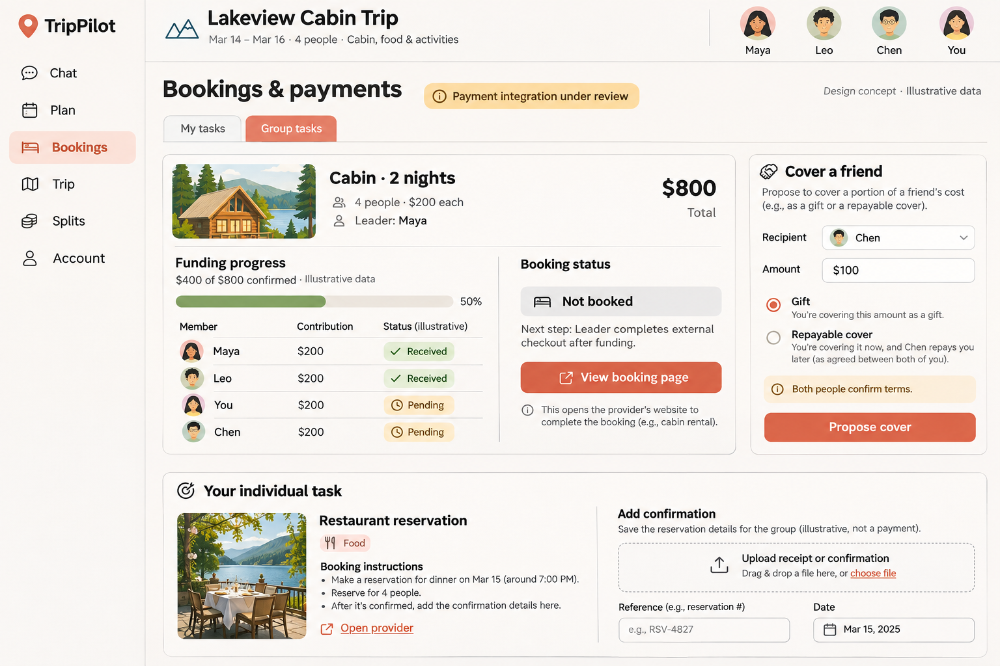
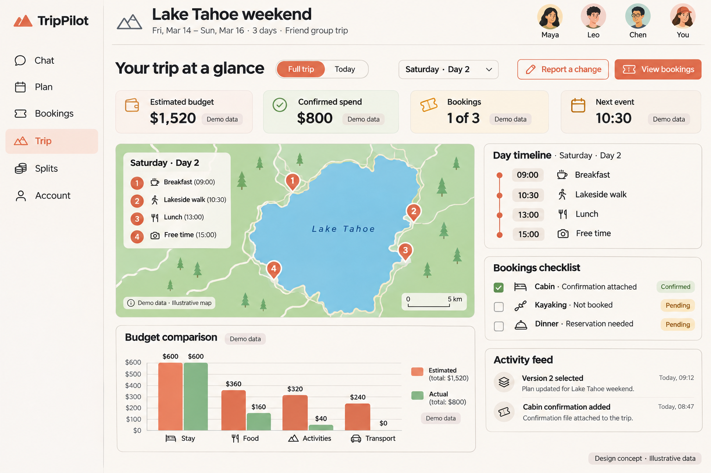
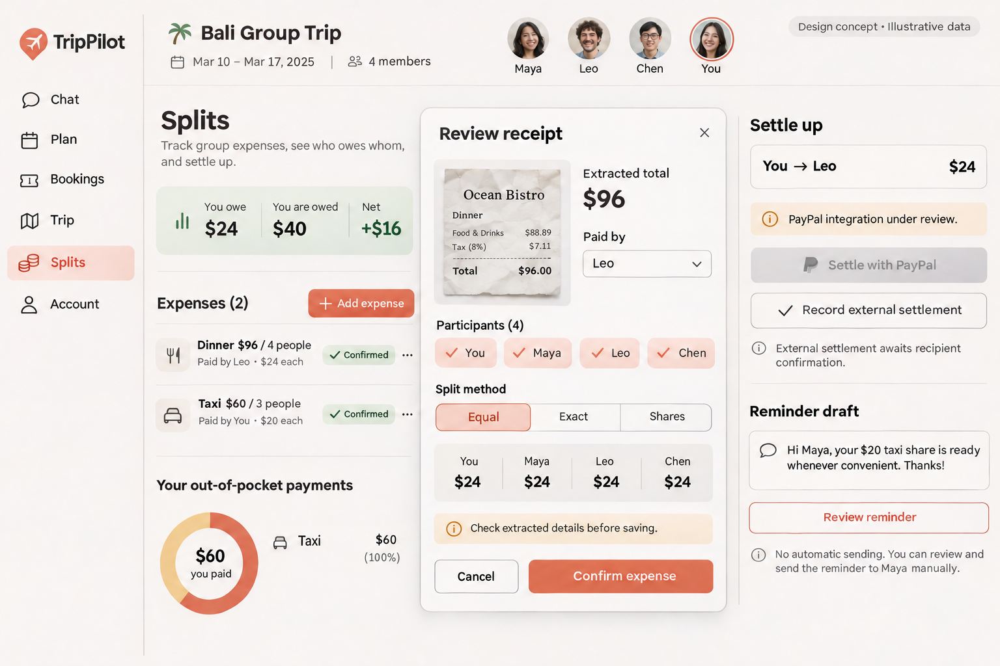
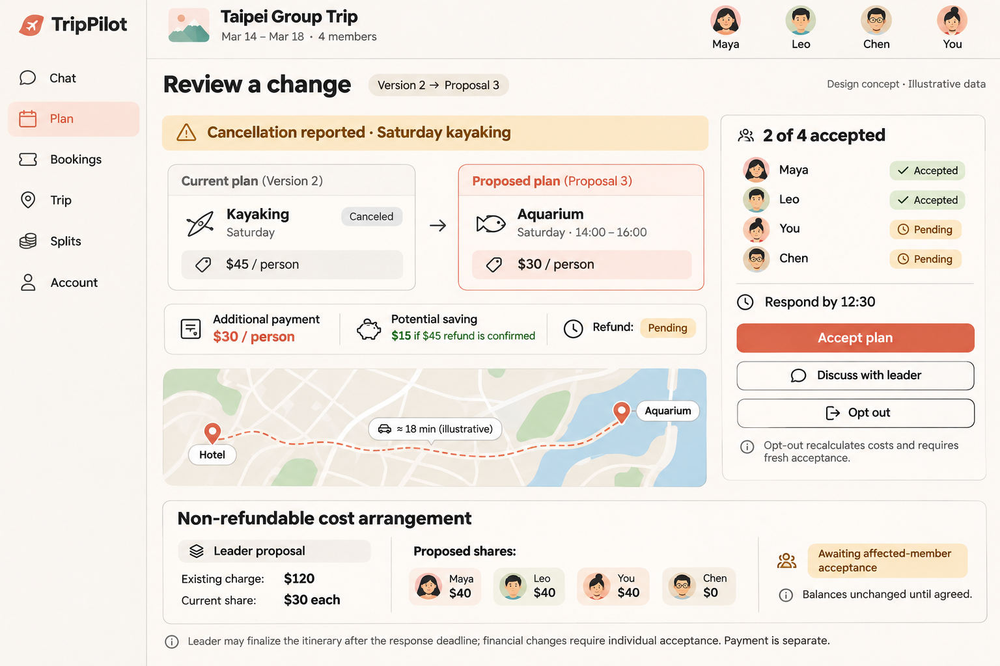
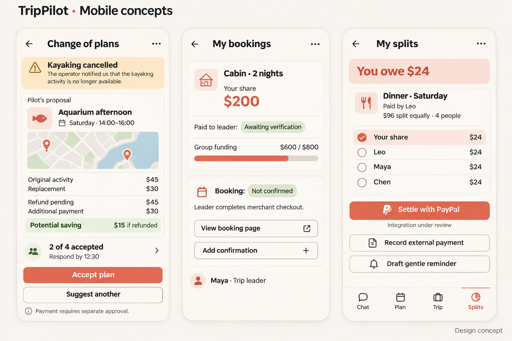

# TripPilot UI suggestions

Prepared November 3, 2026. These are concept directions for discussion, not implemented screens or an approved visual specification. All names, prices, dates, maps, and places in the images are illustrative. The behavioral notes and confirmed product decisions take precedence over any visual-generation text error.

Latest scope decision: the demo is a **desktop web app only**. The desktop concept is the active direction. The earlier mobile board remains below to preserve the discussion, but is deferred and does not create mobile implementation or testing requirements.

## 1. Desktop planning workspace

Suggested composition: a narrow navigation rail; group chat with Pilot and a compact decision card; a day-wise itinerary/map area; a header showing trip name, current version, and group members.

The leader's `/plan` invocation is explicit. Pilot's response shows sources and price freshness, an assumption summary, and a proposed itinerary. A day selector changes both map and itinerary. A pending version is clearly labeled until the leader selects it. Avoid exposing private budgets/concerns in the public group view.

## 2. Trip setup, travel profile and invitations

The leader starts with trip name, duration/dates, style, and approximate budget. A separate personal profile captures origin, interests, dietary needs, pace, and visibility preferences. Invite links and member status make joining visible.

This concept combines related steps for comparison; the real app should only enable a persistent invite after the group exists. Login is identity, not payment authorization. The pictured invite address and identities are placeholders, not a deployed service.

## 3. Group conversation and decision tools

Shows public conversation next to Four Corners, This or That, rankings, and a private concern input. The decision-tool menu also includes polls and show of hands. Members can share freeform thoughts in chat and explicitly invoke Pilot.

Treat this as a component catalog, not a requirement to display every decision format simultaneously. Pilot should choose a useful question rather than overwhelming the group. Private submissions require private API/event/model-context handling; hiding a label is insufficient. Decisions guide planning and do not authorize transfers.

## 4. Internet research, destination comparison and versions

Compare destination options, sourced estimate breakdowns, day-wise geography, version history, and changed activities/costs. The leader selects the initial plan; later in-trip changes follow affected-member acceptance.

Sample destinations, photos, maps, dates, and estimates are illustrative and independent of other screen fixtures. Mark provider quotes, rough estimates, and unavailable prices distinctly in implementation. The illustrated price breakdown totals USD 380 per person; a version saving is not a confirmed refund.

## 5. Arrival coordination and local transport

The member table separates origin, mode, and arrival time. A travel-group panel lets friends coordinate a shared journey, while the local-transport comparison shows estimated personal versus shared costs.

Mode changes can affect arrival, itinerary participation, and split costs. Maps/travel times require provider evidence; the pictured routes are not navigational instructions. Save arrangements separately from booking a flight, train, rental, or transfer. The initial destination remains a demo choice to be finalized.

## 6. Booking tasks, contributions, covers and confirmations

The shared booking shows its purpose, total, participants, leader, contribution progress, and a separate external booking state. Individual booking tasks provide instructions and provider links. A cover proposal distinguishes gifts from repayable terms. Confirmation upload supports receipt, booking reference, and date.

Payment integration is explicitly under review; the pictured received/pending states are illustrative. The UI must not infer booking success from funding or a browser redirect. Cover terms and any repayment obligation require explicit agreement; the final cover workflow is still a design decision. A booking page link does not guarantee a prefilled cart.

## 7. Trip dashboard and day-wise overview

Full-trip/Today selection, a day picker, event map, timeline, estimated-versus-actual category chart, booking checklist, and activity feed provide one overview. A clear action opens the change/replanning flow.

Use independent values for estimates, recorded purchases, and transferred contributions. Bookings require their own confirmation evidence. This is a different illustrative state from the booking screen; do not seed every image as one consistent transaction timeline. Generated dates and region labels are placeholders rather than a final demo itinerary.

## 8. Expenses, receipt review, personal balances and settlement

Shows manual expense entry, a receipt-review panel, equal/exact/share split choices, member participation, personal balance, settlement actions, and a gentle reminder draft. Users verify extraction before saving. External settlement awaits recipient confirmation; the PayPal action remains unavailable until a supported integration is selected.

Fixture arithmetic: dinner USD 96 split four ways makes Your share USD 24 owed to Leo. A USD 60 taxi paid by You and split among You, Maya, and Chen makes each share USD 20; Maya and Chen together owe You USD 40. Net receivable is USD 16. Amount paid out of pocket and personal cost share are different metrics; label any chart accordingly. Reminder text is reviewed before a member chooses to send it.

The selected v2 image corrects receipt arithmetic (USD 88.89 + USD 7.11 tax = USD 96.00) and labels the chart as out-of-pocket payments. The earlier unselected draft is retained locally for provenance.

## 9. During-trip changes, opt-out and cost arrangements

Compares current and replacement activities, additional cash required, conditional savings, uncertain refund status, route changes, and affected-member responses. Members can accept, discuss with the leader, or opt out. A confirmed opt-out creates recalculated schedules/costs and fresh acceptance.

The lower cost-arrangement card is a separate example for a USD 120 non-refundable charge: four USD 30 shares become three proposed USD 40 shares and one USD 0 share, only if affected members accept. It is not the same USD 45-per-person activity shown above. Pending arrangements do not change balances. The deadline override applies to itinerary finalization after silence, not consent to a new financial obligation or payment.

## 10. Archived mobile concept: deferred beyond the demo

The image is retained as a historical concept only. Its activity replacement, booking task, and split-summary behaviors still belong in the desktop app, expressed as desktop panels/dialogs rather than mobile screens.

The proposal shows additional cash needed, expected net change, and refund uncertainty separately. Acceptance applies to the displayed proposal revision. Show the response deadline and identify when leader finalization is available. No button may imply that itinerary acceptance authorizes payment.

Updated rejection interaction: show "Discuss with leader" and "Opt out" when a member declines. Opt-out presents an impact preview before confirmation, then creates a recalculated proposal requiring fresh acceptance. Keep an unresolved discussion visible rather than treating the member as silent. Existing booked/non-refundable costs remain visible; no opt-out button promises an automatic refund or debt cancellation.

For existing non-refundable costs, show a separate leader-authored "Cost arrangement" card: current share, proposed share, who covers the difference, reason, and affected-member acceptance. Pending arrangements do not change balances. Accepting an arrangement changes the agreed allocation only after all required acceptance; payment remains a separate action.

For a payment task, show recipient, amount, purpose, participants, verified/pending status, and the next human action. The PayPal payment connection remains unresolved; generated mockups must not be treated as evidence that it works. Split balances use deterministic backend calculations. Manual settlement requires confirmation under the proposed workflow.

Implementation refinements: use neutral/amber styling for pending verification and unconfirmed bookings rather than the green pills shown in this concept; show "Cancellation reported" unless a merchant notification is actually verified. Keep payment verification and funding totals consistent with the evidence level. These corrections are part of the intended behavior, not claims that the generated screen is implemented.

## Visual direction

- Warm paper backgrounds, coral action accents, dark readable text, restrained green/amber status indicators.
- Plus Jakarta Sans or a compatible clean sans-serif; clear hierarchy, readable desktop controls, keyboard access, and visible focus states.
- Use the existing component system rather than introducing a second design framework.
- Keep maps useful but secondary to the current decision; never require hovering to see essential actions.
- Maintain clear proposed/selected, funded/booked, estimated/actual, and refund pending/refunded distinctions.
- The planning screen uses side-by-side chat and itinerary/map on desktop. Laptop window resizing should preserve essential controls; mobile-specific view switching is deferred.

## Image provenance and reproduction

Images are generated using the built-in image-generation tool, in `ui-mockup` mode. They are newly generated concepts, not screenshots of an existing app. Final prompts are recorded in [image-prompts.md](image-prompts.md). Outputs are copied into this documentation's `images/` folder so the archive does not depend on an external generated-image path.

Exact prompts for the eight additional desktop concepts are saved in [desktop feature prompts](desktop-feature-prompts.md). Together with the original planning workspace, these cover the discussed product areas; adding images does not expand the first implementation milestone or select unapproved providers/payment routes.
